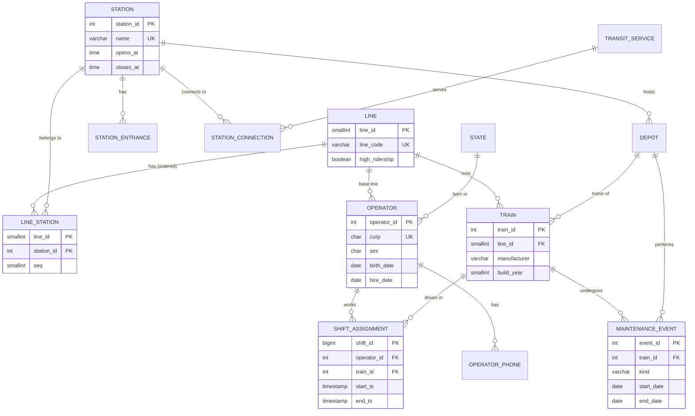

# Data model

PostgreSQL schema `metro` — 14 tables, 7 analytical views. DDL in
[`sql/01_schema.sql`](../sql/01_schema.sql), views in [`sql/02_views.sql`](../sql/02_views.sql).

## Integrity rules enforced by the database

| Rule | Mechanism |
|---|---|
| One row per physical station; transfer stations link to several lines | `UNIQUE (name)` + M:N `line_station` with `UNIQUE (line_id, seq)` |
| A train is never in two maintenance events at once | `EXCLUDE USING gist (train_id WITH =, daterange(...) WITH &&)` |
| An operator never drives two trains at once | `EXCLUDE USING gist (operator_id WITH =, tsrange(...) WITH &&)` |
| A train never has two drivers at once | `EXCLUDE USING gist (train_id WITH =, tsrange(...) WITH &&)` |
| No shift on a train that is in the depot that day | `BEFORE INSERT` trigger `trg_block_shift_on_maintenance` |
| Overnight shifts are valid; shifts last 0–12 h | `TIMESTAMP` start/end + `CHECK` |
| Operators are adults when hired | `CHECK (hire_date >= birth_date + 18 years)` |
| CURP is structurally valid with the right check digit | `CHECK (curp_is_valid(curp))` — SQL implementation of RENAPO's algorithm |
| CURP agrees with birth date, sex and birth state | three `CHECK` constraints |
| "Today" is fixed, so every result is reproducible | one-row `snapshot` table read by all views |

## Views

| View | Purpose |
|---|---|
| `v_failure_spell` | Survival dataset: one row per in-service spell, failure flag, age at start (built with `LAG`/`ROW_NUMBER`) |
| `v_line_kpi` | Fleet, age, failures per train-year, MTBF, 12-month availability per line |
| `v_train_status` | Current status of each train, derived from maintenance records |
| `v_transfer_station` | Stations served by more than one line |
| `v_depot_occupancy` | Daily trains-in-depot vs. bays |
| `v_staffing_coverage` | Share of available trains that received a driver, per day/line/shift |
| `v_operator_profile` | Age, tenure, salary and hours worked per operator |

## Changes from the original course model

| Original | Problem | Now |
|---|---|---|
| Transfer stations stored once per line (`Pantitlán`, `Pantitlán L5`, `Pantitlán L9`, `Pantitlán LA`) | 28 duplicated stations; "which stations are transfers?" could not be answered | Physical station table + ordered M:N membership |
| Shift end stored as `TIME` | Night shifts (22:00 → 05:00) had negative duration | `TIMESTAMP` range with exclusion constraints |
| `Tren.Estatus` boolean | Could contradict maintenance records | Derived in `v_train_status` |
| Dates stamped with `CURRENT_DATE` | Dataset changed every time it was loaded | Fixed snapshot date |
| CURP as free text | 87% of CURPs structurally invalid | Validated in the database |
| `Conductor.Estado` | Comment says "employment status", data holds a state name | `birth_state_code` (FK) checked against the CURP, plus a separate `status` |
